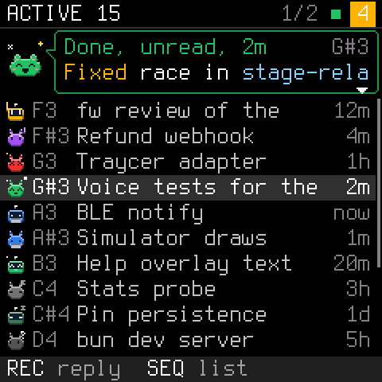
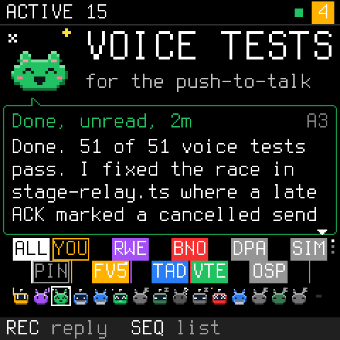
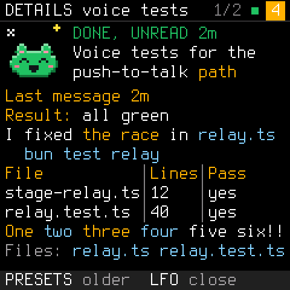

# FM-1 Agent Console

Turns an M-VAVE FM-1 mini keyboard into a hardware console for coding agents running in
[Traycer](https://github.com/traycerai/traycer): see which Claude Code and Codex sessions are working, waiting or
done, open them on the Mac, approve or deny, send canned or spoken prompts, and hear the latest answer read aloud.

<p align="center">
  
  
  
</p>
<p align="center"><sub>The console screen (480 x 480), rendered by the firmware's host build from test fixtures.</sub></p>

It has two halves:

- **Firmware** (`firmware/`): an FM-1 app, FM1 CONSOLE, built on [Dinghy](https://github.com/zvenson/dinghy). It
  draws the session list, the speech bubble and the rich-text details, reads the keys and knobs, and talks to the Mac
  over USB MIDI or Bluetooth LE MIDI (protocol in `docs/protocol.md`).
- **Companion** (`apps/companion`, Bun, macOS): connects to the local Traycer host, keeps the device in sync, runs
  the voice pipeline, and executes what you press.

## Layout

| Path | What |
| --- | --- |
| `apps/companion` | The `fm1-console` CLI and companion process |
| `apps/companion-ui` | Local web UI and simulator view |
| `packages/agent-core` | Backend-neutral session model, copy and validation |
| `packages/agent-adapter-traycer` | Traycer host adapter: sessions, prompts (GUI chats and terminal agents), focus |
| `packages/device-protocol` | The FM1C wire protocol (CC frames, SEQ/ACK, versions 1-7) |
| `packages/device-simulator` | A software FM-1 for tests and development |
| `packages/speech` | Speech-to-text and post-processing |
| `tools/` | Firmware package inspector, Traycer smoke tests and probes, the `traycer-relay` skill CLI |
| `vendor/traycer` | Traycer's protocol and client transport, vendored unchanged (`vendor/traycer/VENDORED.md`) |
| `docs/` | Design, protocol and integration notes |

## Run

Requires macOS, [Bun](https://bun.sh) and a running Traycer host.

```sh
bun install && (cd vendor/traycer && bun install)
bun test
bun apps/companion/src/cli.ts doctor            # read-only environment report
bun apps/companion/src/cli.ts start --sim       # against the software FM-1
bun apps/companion/src/cli.ts start             # real FM-1 on USB ("FM1 CONSOLE")
bun apps/companion/src/cli.ts start --ble "FM1 CONSOLE XXXX"   # Bluetooth, own BLE-MIDI client
```

Building and installing the firmware needs the JieLi AC79 toolchain and SDK: see `firmware/UPSTREAM.md` and
`firmware/README.md`. Flashing third-party firmware onto your FM-1 is at your own risk; `docs/recovery.md` holds the
author's recovery notes.

## Notes

- Live test evidence (screenshots and captures from the author's Traycer sessions) is not published; documents that
  cite `reports/evidence/...` refer to that private record.
- Personal project. Not affiliated with or endorsed by M-VAVE, Traycer, Anthropic or OpenAI.

## Licence

MIT (`LICENSE`), except `firmware/` (GPL-3.0-only, with its upstream authors in `firmware/LICENSING.md`) and
`vendor/traycer/` (MIT, Traycer AI).
